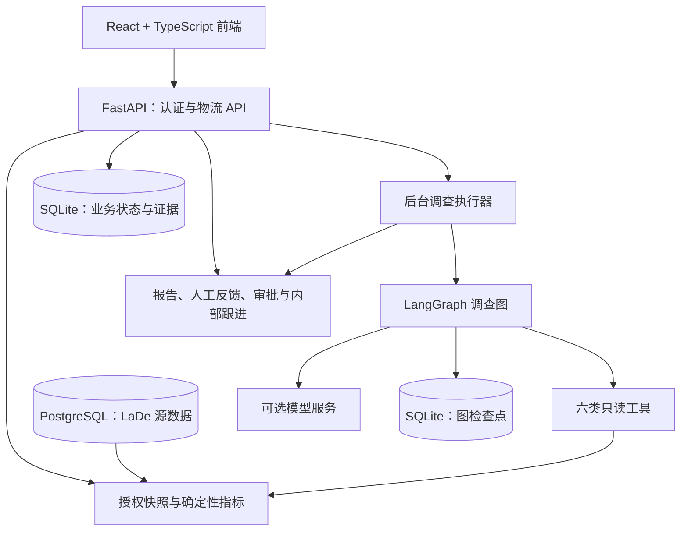

# Scope · 上海物流风险调查助手

基于 **React、FastAPI 和 LangGraph** 的物流风险调查与人机协同应用。围绕指定区域和业务时点，将历史物流数据转换为可追溯的调查证据，支持报告、方案审批与内部跟进。

> 当前为历史数据回放与闭环 Demo。默认使用确定性调查，动态模型调查作为显式实验选项；未接通真实派单系统，不能据此认定已有生产干预收益。

## 核心能力

- **业务时点快照**：仅暴露时点 T 已知的接单、完成及 GPS 信息，屏蔽未来信息；读取时重新检查当前权限。
- **确定性风险指标**：程序计算样本内积压、逾期、临期、近期接单与完成，支持快递员和 AOI 分组；区分缺失、零值与空样本。
- **调查与证据**：六类只读白名单工具，保存调用记录、证据及报告；模型不能自由执行物流 SQL。
- **Agent 编排**：八节点 LangGraph 调查图，支持计划修订、家族预算、无进展停止、部分成果交付和安全节点恢复。
- **连续对话与人机协同**：调查追问、事实与约束、方案草稿、明确提交、跨账号审批、内部回执和新快照复核。
- **成果复用**：知识库查找、阅读、下载和引用历史报告；引用不会自动创建新调查。

当前只有上海物流运营空间。主要页面为智能助手、风险中心、审批中心、知识库、数据中心和设置；旧订单支付分析、汽车供应链业务已退出正式入口，部分代码保留作复用和隔离测试。

## 架构



模型负责选择取证步骤和解释结果；后端校验范围、权限、证据归属、版本和预算，数量与排序由程序计算。当前保持单应用进程。

模型调查图：`context → plan → select → execute → observe → decide → report → finish`，包含条件分支、循环和修订。

## 首次运行

推荐 Node.js 24+、Python 3.11+。macOS / Linux 在仓库根目录执行：

```bash
npm ci
python3 -m venv .venv
.venv/bin/python -m pip install -r requirements.lock.txt
test -e .env || cp .env.example .env
```

编辑 `.env`，设置自己的 `AUTH_SECRET`，再启动：

```bash
npm run dev
```

- 前端：`http://localhost:3003`
- 后端接口文档：`http://localhost:3002/docs`
- 健康检查：`http://localhost:3002/api/health`，仅检查认证 SQLite。

基础服务启动不需要模型或物流源库；**完整物流调查还需要 PostgreSQL 数据、已核验批次和成员授权**。仓库不包含现成账号、私密配置或原始物流数据，也不提供一键空库管理员初始化。Windows 安装、账号、数据和模型配置见 [首次运行说明](docs/getting-started.md)。

## 数据与效果边界

历史数据使用 [LaDe 上海揽收数据](https://huggingface.co/datasets/Cainiao-AI/LaDe)，项目历史审计记录为 **1,424,406 条**。数据需单独获取并遵循原数据集条款；现有导入脚本仍依赖仓库外审计材料，未提供完整独立导入包。

- 2000 年仅为参考时间轴，真实年份未知，不能推断真实星期、节假日或天气。
- 样本来自历史已完成任务，回放积压不等同于生产全量积压。
- 观察到的风险集中不等于责任或因果，审批通过不等于已执行。
- 内部跟进和新快照复核不证明真实派单效果。

历史 T13 对照来自同一事件组的三类问题，共 24 次运行；下表仅使用稳定阶段每种方法的九次运行：

| 指标 | 固定取证 + 模型报告 | 动态 Agent |
| --- | ---: | ---: |
| 有效报告 | 6/9 | 3/9 |
| 已记录 Token | 66,782 | 105,887 |
| 模型调用次数 | 15 | 32 |

动态方法另有两次调用用量未知，已知 Token 比固定方法高 58.6%。结果没有证明动态方法具备质量或成本优势，**G3 仍未通过**。这组固定对照也调用模型，不等于产品默认的确定性调查。历史审核不是独立人工盲审，不应泛化为业务准确率。详见 [对照与审核记录](docs/logistics-execution/t13-reference-rerun.md)。

以上为历史记录，本次仓库整理未重新运行实验。部分原始证据位于未发布的本地 `test-results/` 中。

## 代码导航

| 目录 | 内容 |
| --- | --- |
| `src/logistics/` | 当前物流界面与 API 请求 |
| `src/components/` | 登录、注册与账号界面 |
| `src/supply/` | 复用的原界面组件及历史实现 |
| `backend/` | FastAPI、认证授权、源连接、快照、调查执行与持久化 |
| `project/agents/` | 模型协议、报告校验、覆盖与修订策略 |
| `project/tools/`、`project/workflows/` | 受控工具与状态图 |
| `project/context/`、`project/prompts/` | 上下文组装与提示词 |
| `project/tests/`、`project/evals/` | Agent 检查、宿主集成测试与评测 |
| `tests/`、`scripts/` | 浏览器测试与启动、核验、维护脚本 |
| `docs/`、`plan/` | 使用说明、实施契约与历史记录 |

`project/skills/` 与 `project/memory/` 目前仅有职责说明，不代表已实现自动技能加载或长期记忆。

## 验证与文档

```bash
npm run lint
npm run build
npx playwright test
```

Python 完整回归包含 `backend` 和 `project/tests` 两组，命令与条件见 [首次运行](docs/getting-started.md) 和 [协作约定](AGENTS.md)。离线协议通过不能替代真实模型质量验证；数据库集成须使用隔离库。

- [当前实施状态](docs/logistics-execution/task-status.md)
- [详细运行说明与历史参考](docs/runtime-reference.md)
- [连续对话与协同契约](docs/logistics-execution/v2-chat.md)
- [闭环 Demo 说明](docs/logistics-execution/demo.md)
- [项目问题与改进优先级](docs/项目问题清单与改进优先级.md)
- [知识库现状与改进建议](docs/知识库现状问题与改进建议.md)
- [GitHub 上传说明](docs/github-upload.md)

仓库未附开源许可证；第三方代码、依赖、图片、字体及数据集遵循各自授权。公开上传前需确认项目权属与拟采用的许可证。
